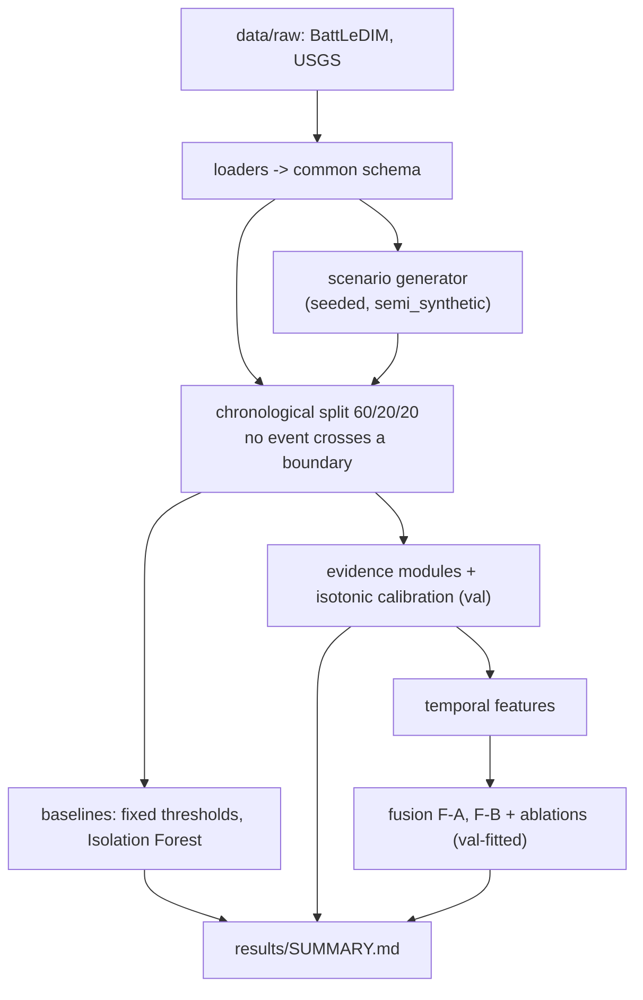

# Architecture

KAMI is a staged pipeline. Raw readings are turned into causal features, scored as two separate evidence streams, analysed for temporal context, and fused into a category, priority, confidence and explanation. A React dashboard shows the result live.

```mermaid
flowchart LR
  subgraph Sources["Virtual sensor nodes (no hardware)"]
    D1["BattLeDIM hydraulic simulation<br/>(flow, pressure) semi_synthetic"]
    D2["USGS river records<br/>(turbidity, conductance -> TDS)"]
    INJ["Scenario injector<br/>(leak, burst, turbidity surge,<br/>TDS shift, combined)"]
  end
  D1 --> NODES["Node fleet<br/>replays JSON readings"]
  D2 --> NODES
  INJ -. "POST /demo/inject" .-> NODES
  NODES -- "topic kami/nodes/&lt;id&gt;/readings" --> BUS{{"Message bus<br/>MQTT (Docker) or in-process (fallback)"}}
  BUS --> WORKER["Ingest worker<br/>validate + store"]
  WORKER --> STORE[("Storage<br/>TimescaleDB or SQLite")]
  WORKER --> PROC

  subgraph PROC["Streaming processor (per node)"]
    F["Causal features<br/>mean, std, rate, slope,<br/>deviation, 24 h lag"] --> EI["Infrastructure evidence<br/>p_infra (calibrated)"]
    F --> EQ["Quality evidence<br/>p_quality (calibrated)"]
    EI --> TI["Temporal context<br/>suddenness, persistence, recurrence"]
    EQ --> TQ["Temporal context<br/>suddenness, persistence, recurrence"]
    TI --> FU["Fusion F-B<br/>Dempster-Shafer, reliability discounting"]
    TQ --> FU
    EI --> FU
    EQ --> FU
    FU --> OUT["Category · priority · confidence · explanation"]
  end

  OUT --> STORE
  OUT --> API["FastAPI<br/>/network /nodes/{id}/state /alerts<br/>/demo/* · WebSocket /ws"]
  API <--> UI["React dashboard<br/>map, node detail, alerts, controls"]
```

## Offline experiments (same code paths)

## Where things live
| Part | Code |
|---|---|
| Datasets, splits, schema | `src/kami/data/` |
| Causal and temporal features | `src/kami/features/` |
| Scenario generator, node fleet, injector | `src/kami/simulator/` |
| Baselines, evidence modules, fusion | `src/kami/models/` |
| Metrics, harness, experiments | `src/kami/eval/` |
| Bus and ingest worker | `src/kami/ingest/` |
| Storage backends | `src/kami/store/` |
| Streaming processor, launcher | `src/kami/live/` |
| API | `src/kami/api/` |
| Dashboard | `frontend/` |

## Modes
- **docker**: Mosquitto (MQTT) and TimescaleDB from `docker-compose.yml`. Implemented; not exercised in the build environment because Docker was absent.
- **fallback**: in-process bus and SQLite behind the same interfaces. Because the bus is in-process, the nodes, worker, processor and API run in one process (`scripts/run_demo.py`).

## Data honesty
All node data are `semi_synthetic`: BattLeDIM is a hydraulic simulation, the USGS series are real river records from Virginia, injected events come from the generator. The map layout is fictional.
