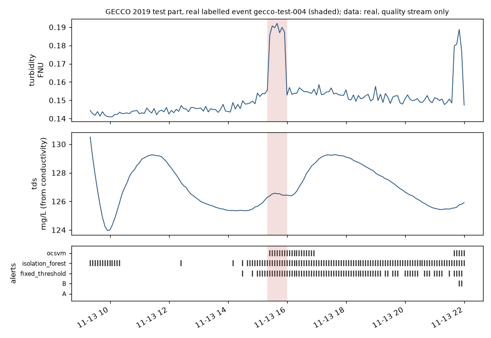
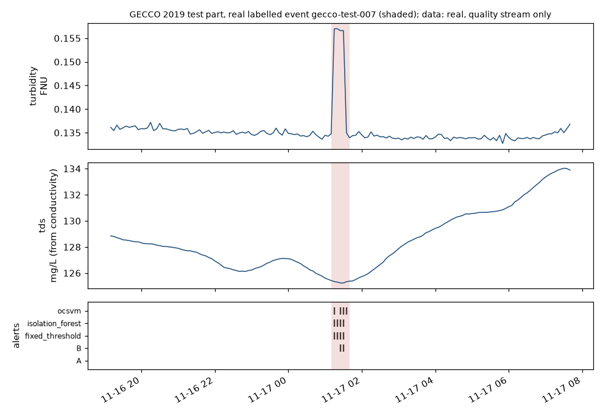

# Real-data test on GECCO 2019 (quality stream only)

Generated by `src/kami/gecco/report.py` (2026-10-17T20:04:47+00:00) from the stored predictions; protocol `docs/gecco_protocol.md` (committed before any test label was read).
Data: GECCO Industrial Challenge 2019 (Zenodo 10.5281/zenodo.4304080, CC-BY-4.0), **real** drinking-water sensor data with labelled events. Scope: **quality stream only (turbidity and TDS from conductivity)**. KAMI's infrastructure results stay semi-synthetic; this test says nothing about leaks or bursts. pH and SAC are not KAMI inputs, so events visible only there cannot be found by design.

## Data

| Split | GECCO file | 5-min steps | events (1 min) | events (5 min) |
|---|---|---|---|---|
| train | 7 (train) | 26496 | 13 | 13 |
| val | 8 (valid) | 10950 | 12 | 12 |
| test | 6 (test), locked | 6330 | 12 | 12 |

## What the test shows

- **Frozen transfer (A):** the Round 2 quality module and rule, trained only on semi-synthetic events in river data, detected 0 of 12 real test events with 0 false alarm segments (it raised no alert at all). The frozen evidence does not transfer to this drinking-water data without refitting.
- **Adapted (B):** refitted on GECCO train and tuned on validation, it detected 4 of 12 test events, event-counted F1 0.444, 0.092 false alarms per day. Against the best baseline on validation (fixed_threshold) the paired difference in event-counted F1 has the interval [-0.783, -0.218]: B is worse on this test part.
- **Read the event metrics with the alert time:** fixed_threshold was in alert for 3.4%, isolation_forest was in alert for 6.0%, ocsvm was in alert for 4.9% of the normal test time, B for 0.1%. The event metrics do not penalise duration: one long alert that overlaps an event counts as a detection and not as a false alarm (Round 2 note). The point F1 and GECCO's own 1-minute score, which do count every alerted step, are A 0.000 / 0.000, B 0.290 / 0.180, fixed_threshold 0.219 / 0.161, isolation_forest 0.156 / 0.116, ocsvm 0.159 / 0.110.

## Test part (locked; one read per model)

Event metrics on 5-minute steps (Round 2 definitions); 95 % bootstrap intervals in brackets (events and days resampled).

| Model | Events detected | Recall | Event-counted F1 | Segment F1 | False alarms / day | Latency median / p90 (h) | Alert time (share of normal steps) | Point F1 | GECCO score (1-min F1) |
|---|---|---|---|---|---|---|---|---|---|
| A: frozen transfer (Round 2 module and rule, nothing refitted) | 0 of 12 | 0.000 [0.000, 0.000] | 0.000 [0.000, 0.000] | 0.000 [0.000, 0.000] | 0.000 [0.000, 0.000] | n/a / n/a | 0.0% | 0.000 | 0.000 |
| B: adapted (same features and model family, refitted on GECCO) | 4 of 12 | 0.333 [0.083, 0.667] | 0.444 [0.133, 0.737] | 0.429 [0.000, 0.737] | 0.092 [0.000, 0.277] | 0.167 / 0.250 | 0.1% | 0.290 | 0.180 |
| baseline: fixed thresholds | 11 of 12 | 0.917 [0.750, 1.000] | 0.917 [0.800, 1.000] | 0.903 [0.761, 1.000] | 0.046 [0.000, 0.139] | 0.083 / 0.167 | 3.4% | 0.219 | 0.161 |
| baseline: Isolation Forest | 11 of 12 | 0.917 [0.750, 1.000] | 0.733 [0.588, 0.889] | 0.674 [0.489, 0.846] | 0.321 [0.137, 0.597] | 0.000 / 0.083 | 6.0% | 0.156 | 0.116 |
| baseline: One-Class SVM | 9 of 12 | 0.750 [0.500, 1.000] | 0.857 [0.667, 1.000] | 0.857 [0.667, 1.000] | 0.000 [0.000, 0.000] | 0.083 / 0.083 | 4.9% | 0.159 | 0.110 |

Best baseline (chosen on validation, before the test read): **fixed_threshold**.

### Paired differences (same resampled events and days)

| Difference | Event-counted F1 | Recall | False alarms / day |
|---|---|---|---|
| B - best baseline | [-0.783, -0.218] | [-0.833, -0.250] | [0.000, 0.139] |
| A - best baseline | [-1.000, -0.800] | [-1.000, -0.750] | [-0.139, 0.000] |
| B - A | [0.133, 0.737] | [0.083, 0.667] | [0.000, 0.277] |

A difference is shown only if its interval excludes 0.

## Validation (tuning data, for comparison)

| Model | Events detected | Event-counted F1 | False alarms / day |
|---|---|---|---|
| A: frozen transfer (Round 2 module and rule, nothing refitted) | 0 of 12 | 0.000 | 0.000 |
| B: adapted (same features and model family, refitted on GECCO) | 8 of 12 | 0.727 | 0.057 |
| baseline: fixed thresholds | 9 of 12 | 0.783 | 0.057 |
| baseline: Isolation Forest | 9 of 12 | 0.692 | 0.141 |
| baseline: One-Class SVM | 9 of 12 | 0.720 | 0.113 |

## Frozen settings

- A: Fusion F-B, frozen Round 2 {'r_min': 0.4, 'tau_p': 6.0, 'lambda': 0.3, 'gamma_infra': 0.98, 'gamma_quality': 0.8} (from `results/fusion/frozen_config.json`).
- B: model `logreg_C1`, rule parameters r_min = 0.4, tau_p = 6, lambda = 0.0, gamma_q = 0.4.
- fixed_threshold: k = 8
- isolation_forest: n_estimators = 100, max_samples = 2048, quantile = 0.999
- ocsvm: nu = 0.01, gamma_mult = 0.1, quantile = 0.999, fit_rows = 20000

## Test events

Latency in hours from the event start to the first alert inside the event; '-' = missed.

| Event | Start | End | Steps | A | B | fixed_threshold | isolation_forest | ocsvm |
|---|---|---|---|---|---|---|---|---|
| gecco-test-001 | 2017-11-08 00:40 | 2017-11-08 00:50 | 2 | - | - | 0.00 | 0.00 | 0.00 |
| gecco-test-002 | 2017-11-08 01:10 | 2017-11-08 01:20 | 2 | - | 0.08 | 0.00 | 0.00 | 0.00 |
| gecco-test-003 | 2017-11-08 01:35 | 2017-11-08 01:55 | 4 | - | 0.00 | 0.00 | 0.00 | 0.00 |
| gecco-test-004 | 2017-11-13 15:20 | 2017-11-13 16:00 | 8 | - | - | 0.00 | 0.00 | 0.08 |
| gecco-test-005 | 2017-11-13 21:35 | 2017-11-13 22:00 | 5 | - | 0.25 | 0.08 | 0.00 | 0.08 |
| gecco-test-006 | 2017-11-14 06:30 | 2017-11-14 06:45 | 3 | - | - | 0.08 | 0.08 | 0.08 |
| gecco-test-007 | 2017-11-17 01:10 | 2017-11-17 01:40 | 6 | - | 0.25 | 0.08 | 0.08 | 0.08 |
| gecco-test-008 | 2017-11-17 12:25 | 2017-11-17 12:40 | 3 | - | - | 0.00 | 0.00 | 0.00 |
| gecco-test-009 | 2017-11-20 17:30 | 2017-11-20 17:50 | 4 | - | - | 0.17 | 0.08 | - |
| gecco-test-010 | 2017-11-24 21:30 | 2017-11-24 21:50 | 4 | - | - | 0.08 | 0.08 | 0.08 |
| gecco-test-011 | 2017-11-27 12:40 | 2017-11-27 13:00 | 4 | - | - | 0.17 | 0.17 | - |
| gecco-test-012 | 2017-11-28 22:00 | 2017-11-28 22:20 | 4 | - | - | - | - | - |

## Figures

## Test reads

- A: read 2026-10-17T20:01:49.081782+00:00, completed 2026-10-17T20:01:49.436809+00:00
- B: read 2026-10-17T20:03:21.180318+00:00, completed 2026-10-17T20:03:21.317417+00:00
- fixed_threshold: read 2026-10-17T20:03:24.091007+00:00, completed 2026-10-17T20:03:24.215683+00:00
- isolation_forest: read 2026-10-17T20:03:45.638092+00:00, completed 2026-10-17T20:03:46.030730+00:00
- ocsvm: read 2026-10-17T20:04:07.519220+00:00, completed 2026-10-17T20:04:08.191664+00:00
